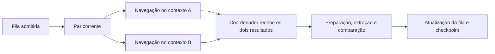

# AmbiDiff · Navegação assíncrona na etapa 3

A referência é o commit `5d31efdc84de8aeaf8e9266b3c68adfb62390962` da
branch `experimento/motor-eficiencia-v2`, com as Etapas 1 e 2.

## Arquitetura anterior e experimental

Na Etapa 2, o scanner retira um par admitido da fila e abre seus dois
endereços em sequência com `playwright.sync_api`. O Chromium oculto mantém
uma página de coleta em cada contexto, com cookies independentes, viewport
comum e interceptação de requisições. A abertura tenta
`domcontentloaded`, valida o DOM após timeout, pode aguardar `commit` e
trata `ERR_ABORTED` com recuperação limitada. O scanner classifica os dois
resultados antes da preparação, da extração e da comparação.

As sondas, rolagem, abas, elementos, fragmentos, inspeção visual, cliques
opcionais e capturas chamam métodos síncronos do Playwright. A geração de
evidências cria contextos próprios no mesmo Chromium e preserva as
verificações de prontidão, dimensões e reuso da Etapa 2. Os checkpoints
persistem fila, estados e resultados em transações do coordenador, que
também decide a admissão de candidatos e a recuperação de páginas.

O experimento usa a API pública `playwright.async_api` em um único
`asyncio.Runner` por varredura. Uma ponte limitada aos métodos usados pelo
scanner mantém a preparação, a extração e as evidências no mesmo
documento e no mesmo fluxo existente. Dentro do loop, dois comandos
`goto` podem progredir juntos. Os comandos das demais etapas são
executados em sequência. O coordenador, a comparação e a escrita de
arquivos correm fora do loop na mesma thread. Os callbacks de rota
escolhem a ação da política existente e a API assíncrona a executa
dentro do loop.

## Mudanças implementadas

- Apenas o par corrente executa dois trabalhos de navegação. Inspeções
  unilaterais, cliques e evidências seguem em sequência. O scanner lê os
  resultados na ordem configurada dos ambientes.
- A espera consulta o evento de interrupção a cada 50 ms. Em caso de
  interrupção no lote, cancela e drena as tarefas Python e devolve o par
  à fila. O fechamento dos contextos encerra comandos ainda ativos no
  Chromium. A tentativa parcialmente navegada permanece pendente no
  checkpoint.
- Se uma página ou o Chromium fechar, o lote concede até 100 ms à
  entrega da desconexão e drena as tarefas restantes. Quando o outro
  `goto` é cancelado, a recuperação recria também sua página antes
  de reutilizar o contexto. Isso evita que uma navegação que ainda
  exista no Chromium alcance o par seguinte.
- O tempo decorrido do lote aparece em
  `desempenho.etapas_coleta_segundos.navegacao_html`. As durações por
  posição em `desempenho.navegacao_operacoes_segundos` podem se
  sobrepor. Elas incluem o tempo de recuperação da abertura e o
  trecho medido das operações canceladas. Na retomada de um checkpoint
  anterior à Etapa 3, o agregado decorrido inclui o trecho anterior
  e as durações por lado passam a ser registradas a partir da retomada.
- A aplicação mantém o modo síncrono por padrão. Para um ensaio controlado
  com Python 3.11 ou posterior, no PowerShell defina `$env:AMBIDIFF_NAVEGACAO_ASSINCRONA = '1'` antes de
  executar `.\INICIAR_AMBIDIFF.bat`. Chamadas Python podem usar
  `executar(..., navegacao_assincrona=True)`. A escolha pode ser feita
  novamente em cada invocação, inclusive durante a retomada.

## Arquivos modificados

| Arquivo | Mudança |
| --- | --- |
| `ambidiff/playwright_async.py` | Sessão experimental, adaptação dos comandos usados pelo scanner e despacho das decisões de rota. |
| `ambidiff/navigation_async.py` | Navegação de um par, recuperação, cancelamento e medição por lado. |
| `ambidiff/paired.py` | Escolha do motor e consumo dos resultados na ordem do par. |
| `ambidiff/core.py` e `ambidiff/navigation.py` | Ativação experimental e reutilização das sondas de recuperação. |
| `ambidiff/diagnostics.py` | Tempos por lado e delimitação do escopo. |
| `tests/fixtures_perf.py` | Latências controladas por lado nos servidores de loopback. |
| `tests/test_navigation_async.py` | Regressões do modo experimental. |
| `docs/navegacao-assincrona-etapa-3.md` | Arquitetura, resultados e recomendação. |

## Resultados dos testes

| Verificação | Resultado |
| --- | --- |
| `python -B -m unittest discover -s tests -v` na Etapa 2 | 333 testes aprovados em 191,694 s. |
| `python -B -m unittest discover -s tests -v` neste checkout | 343 testes aprovados em 232,845 s, incluindo 10 do experimento. |
| `node --check web/static/app.js` e `git diff --check` | Aprovados. |

As duas suítes completas passaram sem falhas nem saltos. Nos testes
iniciais do modo experimental, o primeiro erro de página fechada
cancelava cedo a tarefa irmã e a recuperação chegava antes do evento
de desconexão. A janela de drenagem corrigiu a corrida observada.
O teste de fechamento real e o de cancelamento da página irmã
passaram após a correção e na suíte completa.

As regressões usam Chromium real em loopback para verificar sobreposição
das duas aberturas, isolamento de cookies, ordem da fila, conteúdo tardio,
ÁUDIOS, equivalência de IDs e pixels, timeout unilateral, HTTP 503,
redirecionamentos, interrupção com as duas tarefas ativas, recuperação de
página e navegador, retomada de checkpoint síncrono e bloqueio de POST.
Um teste isolado verifica a abertura por `commit` após timeout e a
recuperação de `ERR_ABORTED` por inspeção do DOM. Um ensaio adicional
com cliques opcionais produziu as mesmas observações funcionais,
divergências e IDs nos dois modos.

## Benchmark

Nos dois checkouts, Linux, Python 3.12.14, Playwright 1.64.0 e Chromium
154 do sistema foram os mesmos. O worker comparou PRD e DES sobre os
mesmos servidores de loopback, com comparação inteligente, capturas e
relatórios. Os cenários usaram `portais_perf(2)`, com espera fixa por
resposta HTTP quando indicada, em três processos independentes por
versão, intercalados. A fixture dinâmica contém aba, conteúdo publicado
após 600 ms e conteúdo ativado por rolagem.

A Etapa 2 foi medida no próprio checkout de referência. Um cronômetro
envolveu `navigation.abrir` para medir cada lado, e os demais tempos
vieram do diagnóstico. O total do worker também foi medido externamente
até seu retorno.

| Mediana (s) | Estável 0/0 ms | Estável 450/750 ms | Dinâmico 180/310 ms |
| --- | ---: | ---: | ---: |
| Coleta do motor | 5,778 → 5,464 | 8,753 → 7,805 | 24,625 → 24,252 |
| Total do worker | 5,996 → 5,696 | 8,995 → 8,040 | 24,810 → 24,428 |
| Navegação decorrida | 0,565 → 0,490 | 2,687 → 1,766 | 1,319 → 0,887 |
| Operações em PRD | 0,336 → 0,332 | 1,084 → 1,134 | 0,597 → 0,655 |
| Operações em DES | 0,229 → 0,482 | 1,602 → 1,760 | 0,753 → 0,885 |
| Preparação e estabilização | 1,168 → 1,194 | 1,185 → 1,162 | 4,107 → 4,131 |
| Extração de DOM | 0,173 → 0,152 | 0,197 → 0,142 | 1,868 → 1,856 |
| Evidências | 2,710 → 2,563 | 3,474 → 3,523 | 16,131 → 16,216 |

Cada célula mostra Etapa 2 → experimental. Os atrasos são PRD/DES.
Os cronômetros por lado são inclusivos e suas medianas foram calculadas
separadamente. Somá-las contaria parte da espera duas vezes.

Com 450/750 ms de atraso, a mediana da navegação decorrida caiu 34,3%
e a do worker caiu 10,6%. Nesse cenário, o worker variou de 8,911 a
9,038 s na Etapa 2 e de 7,692 a 8,144 s no experimento. No dinâmico,
a navegação caiu 32,8% pela mediana, mas a maior parte do trabalho
continuou nas evidências e na preparação. O total do worker variou
de 24,593 a 25,451 s na referência e de 24,413 a 25,092 s no modo
experimental. A sobreposição limita a leitura da diferença no total.

| Cenário | Páginas com DOM preservado | Pares comparados | Inconclusivos | Falhos | Divergências | PNGs |
| --- | ---: | ---: | ---: | ---: | ---: | ---: |
| Cada cenário estável e dinâmico | 4 | 2 | 0 | 0 | 9 | 18 |
| HTTP 503 e redirecionamento divergente | 2 | 1 | 1 | 1 | 1 | 2 |

Todos os cenários preservaram itens extraídos, ordem e estados dos pares,
divergências e IDs. Os PNGs comparados tinham as mesmas referências, pixels
RGB e marcações. O cenário de HTTP 503 e redirecionamento teve uma execução
por versão e preservou a falha de acesso e a observação de destino distinto.

Em uma rodada separada do cenário 450/750 ms, o maior RSS amostrado
foi de 1.278,1 MiB na Etapa 2 e 1.278,3 MiB no experimento. O Linux
listou os RSS de Python, driver e processos descendentes do Chromium
com uma pausa de 75 ms entre amostragens. Memória compartilhada pode
aparecer em mais de um processo. Uma rodada por versão descreve o
pico observado nessa amostra.

## Riscos, limites e recomendação

- A diferença de momento de abertura pode mudar a idade do DOM quando
  a preparação começa. As janelas de observação da Etapa 2 permanecem
  aplicáveis. Aplicações com timers mais longos do que essas janelas
  podem expor estados que os cenários locais não reproduzem.
- A ponte é interna ao scanner e cobre suas operações atuais. Uma
  futura chamada Playwright pode exigir adaptação. A duplicação dos
  passos de timeout e `ERR_ABORTED` merece atenção em mudanças na
  política de navegação. As expressões JavaScript usadas nesses
  passos são compartilhadas.
- A latência foi introduzida no servidor local. Congestionamento,
  autenticação, estado de sessão, proxies e variação de rede de
  portais institucionais ficaram fora desta validação. A suíte no
  Windows também ficou fora desta rodada.

**Recomendação.** Manter a implementação como modo experimental para
varreduras com espera relevante de navegação e manter o síncrono como
padrão. Os resultados em loopback justificam testar a abordagem em
cenários mais representativos e em Windows antes de promover o modo.
A prioridade em páginas dinâmicas continua sendo medir os custos de
preparação e evidências, que predominam nessa amostra.
